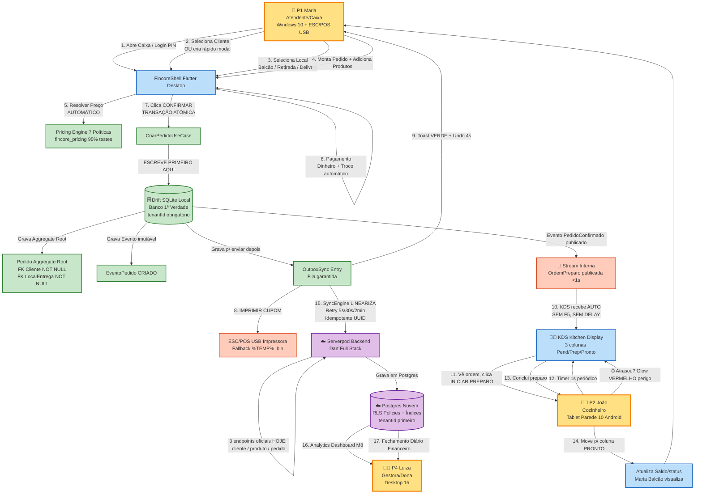
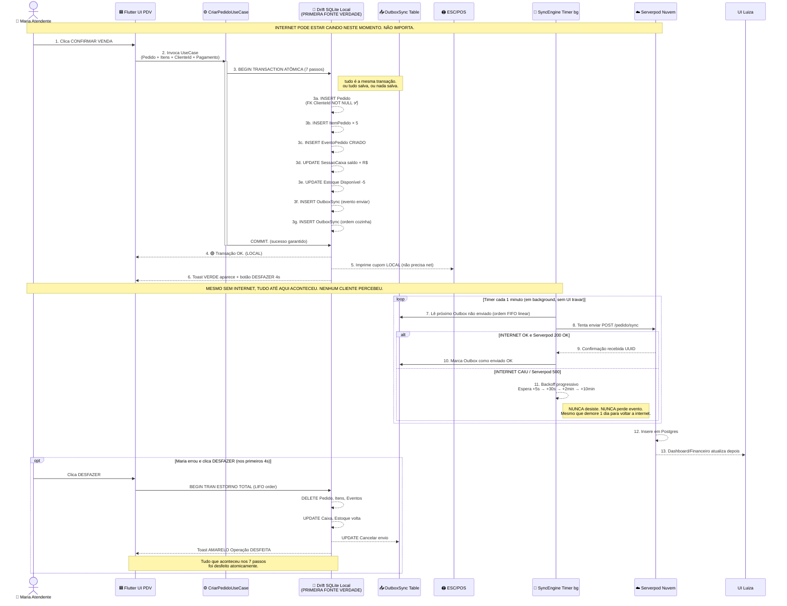
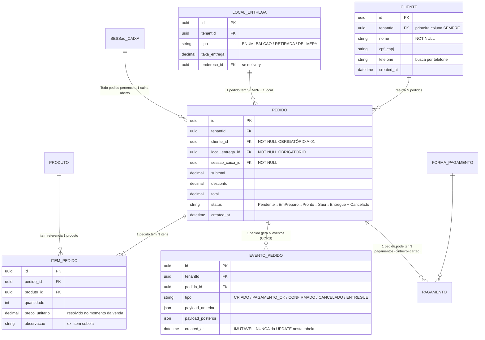

# FINCORE ARCHITECTURE ATLAS v1.0
## Atlas Visual da Arquitetura — Diagramas, Não Texto

> **Document ID**: 017_Architecture_Atlas
> **Version**: 1.0.0
> **Status**: ✍️ Ativo — atualizado após qualquer ADR que altere diagramas.
> **Owner**: Chief Software Architect
> **Depende de**: 100_platform_core_architecture.md, 006 Decision Tree, ADRs.
> **Obrigatoriedade**: 🟡 CONTEXTUAL — todo arquiteto, tech lead e dev senior abre este documento ANTES de propor alteração arquitetural.
> **Regra de ouro**: **Uma imagem vale mais do que 1000 linhas de código.** Arquitetura que não cabe em um diagrama é arquitetura ruim.

---

## 🎯 POR QUE ESTE ATLAS EXISTE?

> 90% das discussões arquiteturais que duram 2 horas, se o time tivesse desenhado um diagrama primeiro, durariam 10 minutos.
>
> Nós temos a tendência de EXPLICAR arquitetura por texto. O cérebro humano não entende arquitetura por texto. O cérebro entende por DIAGRAMA. Todo desenvolvedor novo ao entrar, ao invés de ler 30 páginas, vê 5 diagramas e entende 80% de como o sistema funciona.
>
> Este é o objetivo do Atlas: **a verdade da arquitetura mora nos diagramas AQUI**. O texto em outros documentos existe para explicar os diagramas, não o contrário.

---

# 🗺️ DIAGRAMA 1 — VISÃO GERAL COMPLETA DO SISTEMA (Pessoa → Produção)

> **Esta é a primeira coisa que todo mundo vê. Do início ao fim da jornada de 1 venda.**



> **4 Cores Oficiais do Atlas**: Amarelo = Pessoa Real | Azul = UI Flutter | Verde = Domínio / Banco Local | Roxo = Nuvem | Laranja = Hardware

---

# 🏛️ DIAGRAMA 2 — CLEAN ARCHITECTURE + PORTS & ADAPTERS (Camadas Oficiais)

```mermaid
graph TD
    subgraph CAMADA_0_EXTERNA [📱 CAMADA 0 — UI + Frameworks Externos (MAIS VOLÁTIL)]
        UI_WIDGET[Flutter Widgets<br/>ClientesPage / PDV Wizard / KDS UI]
        UI_CONTROLLERS[Controllers<br/>PdvExpressController KdsController]
        DS[Design System<br/>fincore_design_system]
        HARDWARE_EXT[Impressora ESC/POS USB<br/>Share Windows]
    end

    subgraph CAMADA_1_APRESENTACAO [🎮 CAMADA 1 — Aplicação / Presentation]
        PORTS_UI[🔵 Portas Interfaces (Abstract)<br/>ICriarPedidoUseCase<br/>IBuscarClientes]
    end

    subgraph CAMADA_2_USUCASES [⚙️ CAMADA 2 — Use Cases (Orquestração)]
        UC_CRUD[CadastrarClienteUseCase<br/>EditarProdutoUseCase]
        UC_TRANSACIONAL[CriarPedidoUseCase 7 passos<br/>→ Aggregate Root + Evento + Outbox]
    end

    subgraph CAMADA_3_DOMINIO [💚 CAMADA 3 — DOMÍNIO (INALTERÁVEL, NÃO CONHECE NADA DE FORA)]
        AGG_ROOT[Aggregate Roots<br/>📦 Pedido<br/>📦 SessaoCaixa<br/>📦 LoteProducao]
        ENTITY[Entities Master Data<br/>👤 Cliente<br/>📦 Produto<br/>💲 FormaPagamento<br/>📍 LocalEntrega]
        VAL_OBJ[Value Objects<br/>💳 CPFValue<br/>🏠 EnderecoValue<br/>💲 DinheiroValue]
        DOM_SVC[Domain Services Puros<br/>💲 Pricing Engine 7 Políticas (95% testes)]
        EVENTS_DOM[Eventos Domínio Imutáveis<br/>📢 PedidoConfirmadoEvent<br/>📢 OrdemConcluidaEvent]
    end

    subgraph CAMADA_4_INFRA [🛠️ CAMADA 4 — Infraestrutura / Implementações Reais]
        ADAPTERS_DRIFT[🟢 Adapters Drift SQLite<br/>ClienteDriftRepository<br/>PedidoDriftRepository]
        ADAPTERS_SERVERPOD[🟣 Adapters Serverpod Nuvem<br/>ClienteEndpoint Serverpod<br/>PedidoEndpoint]
        OUTBOX_IMPL[OutboxSync Implementation<br/>Drift + Timer]
        SYNC_IMPL[SyncEngine Linear Idempotente<br/>Retry Backoff 5s/30s/2m]
    end

    %% REGRAS DAS SETAS (DEPENDÊNCIAS SEMPRE APONTAM PARA DENTRO)
    UI_WIDGET -->|usa| UI_CONTROLLERS
    UI_CONTROLLERS -->|usa via DI| PORTS_UI
    PORTS_UI -->|é implementado por| UC_CRUD
    PORTS_UI -->|é implementado por| UC_TRANSACIONAL
    UC_CRUD -->|Orquestra| AGG_ROOT
    UC_TRANSACIONAL -->|1 transação = 1 Aggregate| AGG_ROOT
    AGG_ROOT -->|usa| ENTITY
    AGG_ROOT -->|usa| VAL_OBJ
    AGG_ROOT -->|publica| EVENTS_DOM
    ENTITY -->|chama| DOM_SVC
    DOM_SVC -->|puro, sem side effect| DOM_SVC

    %% Adapter implementa a porta de repositório do domínio
    ADAPTERS_DRIFT -->|Implementa IRepository<T>| AGG_ROOT
    ADAPTERS_SERVERPOD -->|Implementa INuvemSync| SYNC_IMPL
    OUTBOX_IMPL -->|Grava em| ADAPTERS_DRIFT
    SYNC_IMPL -->|Lê Outbox → Envia| ADAPTERS_SERVERPOD

    %% Styling
    classDef maisinterno fill:#c8e6c9,stroke:#2e7d32,stroke-width:3px;
    classDef meio fill:#fff9c4,stroke:#f9a825,stroke-width:2px;
    classDef maisexterno fill:#bbdefb,stroke:#0d47a1,stroke-width:2px;

    class AGG_ROOT,ENTITY,VAL_OBJ,DOM_SVC,EVENTS_DOM maisinterno;
    class UC_CRUD,UC_TRANSACIONAL,PORTS_UI meio;
    class UI_WIDGET,UI_CONTROLLERS,DS,HARDWARE_EXT,ADAPTERS_DRIFT,ADAPTERS_SERVERPOD,OUTBOX_IMPL,SYNC_IMPL maisexterno;
```

> **REGRA NÃO NEGOCIÁVEL**: Nenhuma seta pode apontar de dentro para fora. A camada DOMÍNIO (verde centro) NUNCA pode importar Flutter, Drift, Serverpod ou qualquer coisa externa. Se você ver um `import 'package:drift/drift.dart'` na pasta domain → VIOLAÇÃO GRAVE. Reverte PR.

---

# 📶 DIAGRAMA 3 — OFFLINE-FIRST FLOW CORE (Como a verdade sempre fica local)



> **Lição do diagrama**: Serverpod é **secundário**. O Drift local é soberano. Se amanhã a AWS cair por 2 dias, o cliente continua vendendo normalmente. Quando a AWS voltar, tudo sincroniza.

---

# 🧩 DIAGRAMA 4 — PEDIDO AGGREGATE ROOT (Relações Oficiais)



> **Observação importante**: EventoPedido é **IMUTÁVEL**. NUNCA usamos UPDATE nesta tabela. Todo evento que aconteceu no pedido fica gravado para sempre. Isto é a base de Auditoria e reconstrução de estado. Se apagarmos a tabela Pedido inteira, conseguimos reconstruir 100% do estado apenas rodando o replay de EventoPedido. Isso é CQRS / Event Sourcing.

---

# 🧭 DIAGRAMA 5 — HIERARQUIA DE GOVERNANÇA DO PROJETO (NÃO É CÓDIGO, É A ESTRUTURA QUE CONTROLA O CÓDIGO)

```mermaid
flowchart TD
    subgraph NIVEL_0 [NÍVEL 0 — FILOSOFIA / LEI SUPREMA (CONGELADO)]
        C000[000_Project_Constitution.md<br/>14 Princípios Inalteráveis<br/>Pirâmide Verdade + 3 Comitês]
    end

    subgraph NIVEL_1 [NÍVEL 1 — GOVERNANÇA (FPOS)]
        C001[001_Project_Operating_System<br/>Sistema Operacional do Projeto]
        C005[005_Development_Playbook<br/>Ciclo Vida 18 Etapas]
        C006[006_Decision_Tree<br/>Árvore 5 nós + 21 Regras Obrigatórias]
    end

    subgraph NIVEL_2 [NÍVEL 2 — REFERÊNCIA & ESTADO]
        C013[013_Project_State<br/>Onde estamos? Qual próxima tarefa?]
        C015[015_Glossary<br/>Palavra → Definição oficial]
        C016[016_FAQ<br/>Perguntas repetidas → Resposta pronta]
        C017[017_Architecture_Atlas<br/>5 Diagramas (ESTE ARQUIVO!)]
        C018[018_Project_Why<br/>Por que usamos Drift / Serverpod?]
        C019[019_Project_Memory<br/>Linha do tempo decisões históricas]
    end

    subgraph NIVEL_3 [NÍVEL 3 — DECISÕES ESPECÍFICAS]
        ADR[300_decisions/*.md ADR<br/>Decisão Arquitetura individual]
        PRD[100-199 PRDs<br/>120 Domínios, 125 Fluxos Operacionais]
        AUD[auditorias/*.md<br/>Trimestral Estado Produto]
    end

    subgraph NIVEL_4 [NÍVEL 4 — PROCESSOS / TEMPLATES]
        TMP[templates/*.md]
        DOD[091 Definition of Done]
        ENG[090 Engineering Process]
    end

    subgraph NIVEL_5 [NÍVEL 5 — IMPLEMENTAÇÃO (ÚLTIMO)]
        CODE[packages/** lib/*.dart<br/>Código Fonte & Testes]
    end

    %% HIERARQUIA: de cima controla debaixo. NUNCA ao contrário.
    C000 -->|1. Dita regras para| C001
    C001 -->|2. Orquestra| C005
    C001 -->|2. Orquestra| C006
    C001 -->|3. Referência| C013
    C001 -->|3. Referência| C015
    C001 -->|3. Referência| C016
    C001 -->|3. Referência| C017
    C001 -->|3. Referência| C018
    C001 -->|3. Referência| C019
    C006 -->|Se mudar arquitetura cria| ADR
    C005 -->|Antes de código precisa| PRD
    C005 -->|Após cada 90 dias gera| AUD
    PRD -->|define CASO DE USO que o CODE implementa| CODE
    ADR -->|define padrão que o CODE segue| CODE
    DOD -->|define critério de pronto| CODE
    ENG -->|define processo code review| CODE

    %% Cor
    classDef n0 fill:#d32f2f,stroke:#b71c1c,color:#fff;
    classDef n1 fill:#f57c00,stroke:#e65100,color:#fff;
    classDef n2 fill:#1976d2,stroke:#0d47a1,color:#fff;
    classDef n3 fill:#388e3c,stroke:#1b5e20,color:#fff;
    classDef n4 fill:#7b1fa2,stroke:#4a148c,color:#fff;
    classDef n5 fill:#455a64,stroke:#263238,color:#fff;

    class C000 n0;
    class C001,C005,C006 n1;
    class C013,C015,C016,C017,C018,C019 n2;
    class ADR,PRD,AUD n3;
    class TMP,DOD,ENG n4;
    class CODE n5;
```

> **Hierarquia oficial que o usuário propôs (Governance → Operating System → Engineering → Development → Código)**: NÍVEL 0 (Constitution) = Filosofia. NÍVEL 1 (FPOS/Playbook/Decision Tree) = Governança. NÍVEL 2 (State + Atlas + Why + Memory) = Referência. NÍVEL 3 (ADR + PRD) = Decisões. NÍVEL 4 (Processo) = Execução. NÍVEL 5 = Código. Nunca ao contrário. Código nunca decide arquitetura.

---

## 📋 ATUALIZAÇÃO DESTE ATLAS

**Quando este Atlas tem que ser atualizado?**
1. **TODO ADR aprovado que altere arquitetura** → Atualiza diagrama correspondente NO MESMO PR do ADR.
2. **Nova entidade transacional criada** → Atualiza Diagrama 4 ER.
3. **Nova jornada/Milestone concluída** → Atualiza Diagrama 1 Visão Geral.

**Revisão obrigatória**: Trimestralmente, junto com Auditoria 90 dias (mesmo sem ADR). Verifica se os diagramas ainda batem com a realidade do código.

---

Owner: Chief Software Architect
Última atualização: 2026-07-25 v1.0 Baseline com 5 diagramas fundacionais.
