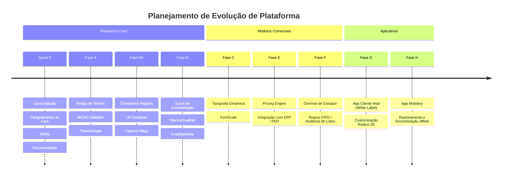

# Roadmap e Dependências de Módulos da Plataforma — FINCORE

Este documento estabelece o roteiro macro de evolução de produtos e a malha de dependências entre os módulos da plataforma FINCORE.

---

## 🗺️ Mapa de Dependências (Package Hierarchy)

O acoplamento deve seguir a direção de dependência de baixo para cima. Módulos de negócio superiores nunca devem ser importados por módulos inferiores:

```text
       [ Módulos de Negócio: CRM / Estoque / Fiscal / Produção ]
                                  │
                                  ▼
                    [ Aplicação ERP / PDV / Apps ]
                                  │
                                  ▼
             [ Fincore Design System & Fincore Pricing ]
                                  │
                                  ▼
                          [ Fincore Core ]
                                  │
                                  ▼
                         [ Fincore Shared ]
```

---

## 📅 Roteiro de Entregas (Roadmap Macro)



---

## 🔗 Dependências Técnicas por Módulo
- **Módulo de Precificação (Pricing Engine)**: Depende diretamente de `fincore_core` (para persistência de tabelas no Drift) e `fincore_shared` (para Value Objects de moedas).
- **Módulo KDS / Cozinha**: Depende de `fincore_core` (outbox sync de ordens de preparo) e `fincore_design_system` (layouts de painéis).
- **Aplicativos Móveis**: Dependem de `fincore_design_system` (com overrides locais de arredondamento) e `fincore_core` (autenticação Supabase e sync engine offline-first).
